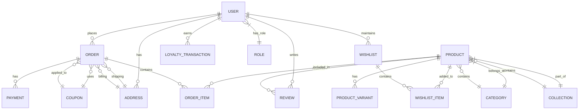

# Database Schema & Entity Relationship Diagram (ERD)

This document details the database schema required for the Eternal E-commerce platform, based on the features available in the frontend UI.

## Entity Relationship Diagram (Mermaid)

## Database Tables & Schema

### 1. Users
Stores all types of users (Customers, Staff, Admins).
*   `id` (PK, UUID)
*   `first_name` (String)
*   `last_name` (String)
*   `email` (String, Unique)
*   `password_hash` (String)
*   `role` (Enum: CUSTOMER, STAFF, ADMIN)
*   `phone_number` (String, Nullable)
*   `loyalty_points_balance` (Integer, Default: 0)
*   `created_at` (Timestamp)
*   `updated_at` (Timestamp)

### 2. Addresses
Stores shipping and billing addresses for users.
*   `id` (PK, UUID)
*   `user_id` (FK -> Users.id)
*   `address_line_1` (String)
*   `address_line_2` (String, Nullable)
*   `city` (String)
*   `state` (String)
*   `postal_code` (String)
*   `country` (String)
*   `is_default_shipping` (Boolean)
*   `is_default_billing` (Boolean)

### 3. Categories & Collections
For organizing products.
*   **Category**
    *   `id` (PK, UUID)
    *   `name` (String)
    *   `slug` (String, Unique)
    *   `description` (Text)
    *   `image_url` (String)
*   **Collection**
    *   `id` (PK, UUID)
    *   `name` (String)
    *   `slug` (String, Unique)
    *   `description` (Text)
    *   `image_url` (String)

### 4. Products
Main catalog items.
*   `id` (PK, UUID)
*   `name` (String)
*   `slug` (String, Unique)
*   `description` (Text)
*   `details` (JSON / Text Array)
*   `category_id` (FK -> Category.id)
*   `collection_id` (FK -> Collection.id, Nullable)
*   `base_price` (Decimal)
*   `original_price` (Decimal, Nullable - for sales)
*   `material` (String)
*   `sku_prefix` (String)
*   `images` (JSON / Text Array - URLs)
*   `status` (Enum: DRAFT, PUBLISHED, ARCHIVED)
*   `created_at` (Timestamp)
*   `updated_at` (Timestamp)

### 5. Product Variants (Inventory)
Handles sizes, colors, and stock levels.
*   `id` (PK, UUID)
*   `product_id` (FK -> Product.id)
*   `size` (String)
*   `color_name` (String)
*   `color_hex` (String)
*   `sku` (String, Unique)
*   `stock_quantity` (Integer)
*   `price_override` (Decimal, Nullable)

### 6. Orders & Order Items
Transactions and purchased items.
*   **Order**
    *   `id` (PK, UUID)
    *   `user_id` (FK -> Users.id, Nullable for guest checkout)
    *   `order_number` (String, Unique)
    *   `status` (Enum: PENDING, PROCESSING, SHIPPED, DELIVERED, CANCELLED)
    *   `total_amount` (Decimal)
    *   `discount_amount` (Decimal)
    *   `shipping_fee` (Decimal)
    *   `coupon_id` (FK -> Coupons.id, Nullable)
    *   `shipping_address_id` (FK -> Addresses.id)
    *   `billing_address_id` (FK -> Addresses.id)
    *   `tracking_number` (String, Nullable)
    *   `created_at` (Timestamp)
*   **Order_Item**
    *   `id` (PK, UUID)
    *   `order_id` (FK -> Order.id)
    *   `product_variant_id` (FK -> Product_Variant.id)
    *   `quantity` (Integer)
    *   `unit_price` (Decimal)

### 7. Payments
Payment transaction records.
*   `id` (PK, UUID)
*   `order_id` (FK -> Order.id)
*   `payment_method` (String - e.g., 'STRIPE', 'PAYPAL')
*   `transaction_id` (String)
*   `amount` (Decimal)
*   `status` (Enum: PENDING, COMPLETED, FAILED, REFUNDED)
*   `created_at` (Timestamp)

### 8. Coupons
Discounts and promotions.
*   `id` (PK, UUID)
*   `code` (String, Unique)
*   `discount_type` (Enum: PERCENTAGE, FIXED_AMOUNT)
*   `discount_value` (Decimal)
*   `min_purchase_amount` (Decimal, Nullable)
*   `valid_from` (Timestamp)
*   `valid_until` (Timestamp)
*   `usage_limit` (Integer, Nullable)
*   `times_used` (Integer)
*   `is_active` (Boolean)

### 9. Reviews
Customer feedback on products.
*   `id` (PK, UUID)
*   `product_id` (FK -> Product.id)
*   `user_id` (FK -> Users.id)
*   `rating` (Integer, 1-5)
*   `comment` (Text)
*   `status` (Enum: PENDING, APPROVED, REJECTED)
*   `created_at` (Timestamp)

### 10. Wishlists
Saved items for customers.
*   **Wishlist**
    *   `id` (PK, UUID)
    *   `user_id` (FK -> Users.id, Unique)
*   **Wishlist_Item**
    *   `id` (PK, UUID)
    *   `wishlist_id` (FK -> Wishlist.id)
    *   `product_id` (FK -> Product.id)
    *   `added_at` (Timestamp)

### 11. Store Settings & Blogs
*   **Settings** (Key-Value store for global config like Shipping Rates, Taxes)
    *   `key` (String, PK)
    *   `value` (JSON)
*   **Blog_Post**
    *   `id` (PK, UUID)
    *   `title` (String)
    *   `slug` (String, Unique)
    *   `content` (Text)
    *   `author_id` (FK -> Users.id)
    *   `published_at` (Timestamp)
